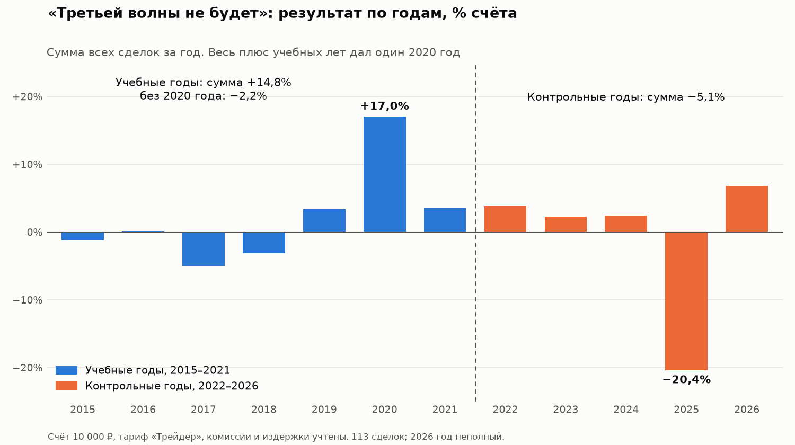

# Я построил систему проверки торговых стратегий. Из сотни с лишним идей отсев на истории прошла одна

Всё, что ниже, — мой личный опыт. Я не профессиональный трейдер, а частный инвестор, который хотел зарабатывать на бирже больше, чем даёт вклад.

## Зачем мне это было нужно

Идей для торговли много: из блогов, из книг, свои собственные. Проверять каждую на живых деньгах — долго и дорого. Пока поймёшь, что идея не работает, уйдут месяцы и часть счёта.

Мне был нужен инструмент, который заранее ответит на простой вопрос: **стоит ли стратегия моих денег и времени — или нет.** И ответит честно, без самообмана.

## Что я построил

Систему проверки и торгового бота. Над ними работает команда ИИ-агентов: один превращает идею в точные правила и принимает работу, второй пишет программу и запускает проверку. Я задаю рамки и решаю, что проверять дальше.

**Что есть у системы:**
- история Московской биржи с 2015 года: дневные цены и цены каждые 10 минут;
- дивиденды, сообщения компаний, прогнозы брокеров, данные по фьючерсам;
- реальные издержки: комиссия по тарифам брокера и разница между ценами покупки и продажи;
- торговый бот и демо-счёт, на котором отобранные стратегии торгуют по заранее записанным правилам.

**Каждая идея получает подробный отчёт по единому шаблону:**
- сколько было сделок и сколько рублей они принесли бы на счёте от 10 000 ₽ до 1 000 000 ₽ — на разных тарифах брокера, с учётом абонплаты;
- результат по годам — видно, не держится ли всё на одном удачном году;
- результат без лучшего года и при удвоенных комиссиях;
- сравнение с фондом денежного рынка и со случайными покупками тех же акций.

### Правила, которые защищают от самообмана

**1. Соперник — фонд денежного рынка.** Это биржевой фонд, который работает почти как вклад: деньги можно забрать в любой день, риск очень небольшой. Его доходность зависит от ставки ЦБ: в среднем за 2015–2026 годы — около 10,6% годовых, в последние годы — 12–18%. Сравнение всегда идёт за один и тот же период, после всех комиссий и с учётом всего счёта, включая упавшие акции, которые ещё не проданы. Свободные деньги стратегии тоже лежат в этом фонде. Если стратегия его не обгоняет, проще купить фонд.

**2. Правила записываются до проверки.** Сначала записывается, когда покупать, когда продавать и что считать успехом. Потом — один прогон. Подкрутить настройки и тихо перезапустить нельзя. Та же идея с другими настройками — это уже новый вариант, и он тоже записывается в общий реестр вместе с итогом, даже провальным. Поэтому всегда видно, сколько вариантов было перепробовано.

Зачем так строго? Представьте: 100 человек подбрасывают монетку по 10 раз. Почти наверняка хотя бы у одного выпадет 8 орлов из 10 или больше. Это не умение — просто людей было много. Со стратегиями то же самое: если перепробовать сто вариантов настроек, **один из них почти наверняка будет выглядеть отлично** — по случайности. Я и сам часто попадал в эту ловушку.

**3. Проверка на новых данных.** Это как экзамен в школе: знания проверяют на новых задачах, а не на тех, что ученик уже решал с подсказкой. Поэтому данные делятся на три части:
1. **2015–2021 годы — «учебные».** На них ищут закономерности и превращают идею в точные правила.
2. **2022–2026 годы — «экзамен».** Готовые правила прогоняются на этих годах один раз, без исправлений.
3. **Половина акций — «второй экзамен».** Эти акции откладываются заранее и не участвуют ни в учёбе, ни в первом экзамене. На них смотрят только в самом конце, перед вердиктом.

Если стратегия хорошо выглядела на учебных годах случайно, на новых данных удача обычно не повторяется. У настоящей закономерности есть шанс проявиться и там — хотя не обязательно в каждом году.

**4. Сравнение со случайными покупками.** Одна случайная покупка даёт случайный результат. Поэтому система тысячу раз повторяет случайный выбор: делает столько же покупок, сколько стратегия, в тех же акциях и в те же месяцы. Получается тысяча случайных прогонов, и виден разброс их результатов.

Пример. В 2020–2021 годах рос почти весь рынок. Допустим, стратегия заработала 20%, а случайные прогоны — в среднем 18%. Значит, заработал в основном рынок, а не стратегия. Стратегия чего-то стоит, только если она лучше почти всех случайных прогонов.

## Что показала проверка

В моём списке больше 180 идей. Больше 100 из них система за несколько недель проверила на истории. Ещё 8 проверяются только на новых данных, потому что истории для них нет. Остальные я закрыл до прогона: не хватило данных или событий. Многие идеи проверялись в нескольких вариантах: например, держать акцию не 10 дней, а 5, или покупать после падения не на 5%, а на 3%.

Каждый новый вариант — как ещё один человек с монеткой из примера выше. Если долго менять настройки, пока результат на истории не станет красивым, рано или поздно повезёт. Но такая подогнанная стратегия обычно проваливается на новых данных.

Почти все идеи не прошли. Вот самое интересное.

**Частая торговля.** Идея — много сделок с небольшим плюсом в каждой. Я проверил десять вариантов внутридневных правил из открытых источников: пробой диапазона первых минут, откат к средней цене дня, покупка после короткого резкого падения, фигура «флаг», продолжение утреннего движения индекса к концу дня. Все — на 10-минутных свечах акций и индекса Мосбиржи, только покупки, на тарифе «Трейдер»: 390 ₽ в месяц плюс комиссия за каждую сделку. До издержек они приносили от −0,04% до +0,10% на сделку, а покупка и продажа вместе обходятся примерно в 0,22%: комиссия брокера плюс разница между ценами покупки и продажи. На сделке в 10 000 ₽ это не больше 10 ₽ заработка и 22 ₽ издержек: в этих правилах каждая сделка в среднем уводила в минус, даже без платы 390 ₽ в месяц. Лимитные заявки, короткие продажи, фьючерсы и тарифы с меньшими издержками я не проверял — о них эта проверка ничего не говорит.

**«Никогда не продавать в убыток».** Идея такая: покупать ликвидные акции, которые устойчиво растут и о которых выходят хорошие новости, и продавать, когда цена вырастет на 6–11%. В убыток не продавать — ждать, пока цена вернётся. Каждый месяц добавлять на счёт новые деньги.

Читать новости моя система пока не умеет — это я хочу добавить в будущем. Поэтому хорошие новости я заменил ценовым признаком: за последний месяц акция выросла и за две недели ни разу резко не упала. Размеры покупок и цели продажи взял из описания идеи, ничего не подбирая. Каждый месяц на счёт добавлялось 10 000 ₽, проверка — с 2015 года.

**Таблица 1. «Никогда не продавать в убыток»: 10 000 ₽ в месяц с 2015 года**

| Вариант | Доходность в год | Худшая просадка | В убыточных акциях в конце |
|---|---|---|---|
| Фонд денежного рынка | +11,5% | 0% | — |
| Растущая акция: покупка по 10 000 ₽, продажа при +11% | +11,1% | −22% | 11% |
| Растущая акция: покупка по 5 000 ₽, продажа при +6% | +11,5% | −11% | 5% |
| Упрощённо: случайная акция, продажа при +5% или +11% | +1…+2% | −45…−53% | 95–98% |
| Упрощённо: самая упавшая за месяц акция, продажа при +5% или +11% | −9…−10% | −72…−80% | 97% |

Доходность считается на все вложенные деньги с учётом пополнений, непроданные акции — по рыночной цене. Для случайной акции — типичный результат из 500 прогонов.

Оба варианта заработали почти ровно столько же, сколько фонд, но счёт по дороге проседал на 11–22%. А выбор акций по этим правилам оказался не лучше случайного выбора среди ликвидных акций индекса.

В годы бурного роста рынка, с марта 2020 по октябрь 2021 года, правила приносили 34–49% годовых. Но индекс целиком за те же месяцы дал ещё больше — 52%. В такие месяцы удачными выглядели почти любые покупки.

Нижние строки таблицы — упрощённые версии, которые я проверил первыми. В этих версиях правило «не продавать в убыток» само по себе не спасло: при покупке случайных или самых упавших акций к концу почти все деньги застряли в бумагах, которые так и не вернулись к цене покупки. Если покупать растущие акции, такого почти нет: в убыточных акциях к концу осталось 5–11% денег.

**Идеи из научных статей.** Закономерности, которые учёные описали для других рынков, — рост цены перед публикацией отчётности, всплеск объёма торгов, дни выплаты зарплат — в моём тесте на Мосбирже подтвердить не удалось. Причины могут быть разными: другой рынок, издержки, мало данных.

**«Утренний рывок продолжится».** Гэп — это когда акция открывается заметно выше или ниже вчерашней цены закрытия. Популярная идея: если растущая акция утром открылась выше на 1,5% и больше, рост продолжится. Я проверял покупку через 10 минут после открытия и продажу в полдень или в конце дня — на 10-минутных свечах, только покупки. Результат после издержек — **от −0,07% до −0,96% на сделку**, и правило оказалось не лучше покупок тех же акций в случайные дни их роста.

**Следить за крупными игроками.** Я проверил два вида данных. Первый — крупные сделки, которые заключают напрямую между участниками, вне биржевого стакана (стакан — это список обычных заявок на покупку и продажу). Второй — позиции компаний во фьючерсах: биржа публикует, сколько контрактов держат юридические лица, а сколько — частные. В обоих случаях я покупал акцию после сигнала и держал 20 торговых дней. В этой проверке ни то, ни другое не помогло выбирать дни для покупки: результат был **не лучше случайного**. Возможно — это только догадка, — к моменту, когда эти данные видны всем, цена уже успевает измениться.

**«Третьей волны не будет».** Это моё наблюдение: небольшое движение цены часто идёт двумя волнами, а третьей нет. Правило: если цена упала двумя волнами, в сумме на 8% и больше, а потом закрылась выше вершины последнего отскока, — купить и держать две недели. Если цена закроется ниже последнего дна, продать раньше: значит, третья волна всё-таки началась. Отчёт по годам хорошо показывает, откуда взялся плюс на учебных годах:

Весь плюс учебных лет дал один 2020 год, без него результат отрицательный. На экзамене — минус. А случайные покупки тех же акций в те же месяцы зарабатывали в среднем +1,9% на сделку против +0,3% у правила.

**Сезонность.** Популярная идея: у каждой акции есть «свои» месяцы — например, конкретная бумага годами растёт в марте. Я проверил такое правило: каждый месяц покупать три акции, которые в этом месяце лучше всего вели себя в прошлые годы.

**Таблица 2. Сезонность: учебные годы против экзамена**

| Период | Стратегия против фонда, в месяц |
|---|---|
| Учебные годы, 2016–2021 | +0,6% |
| Экзамен, 2022–2026 | −2,8% |

На учебных годах правило немного обгоняло фонд, а на экзамене стало сильно отставать: хорошие месяцы часто превращались в плохие. С 2016 года такой счёт терял в среднем 4,3% в год, а фонд приносил 10,4%. Сезонность четырёх отраслей — ритейла, удобрений, авиаперевозок и энергетики, с окнами, выбранными заранее, — тоже не подтвердилась: результат оказался не лучше случайно выбранных месяцев.

## Одна стратегия прошла отсев на истории

Из всех проверенных идей отсев на истории прошла одна стратегия.

Для меня это хороший знак: значит, система не бракует всё подряд, а умеет отличать идеи. Но гарантии, что стратегия действительно работает, у меня нет. Правило придумано на истории, а история может обмануть.

Поэтому сейчас стратегия торгует на демо-счёте по заранее записанным правилам — на данных, которых точно никто не видел. Сделок у неё немного, так что быстрого ответа не будет. Когда их наберётся достаточно, я расскажу о результатах.

## Ограничения

У моей проверки есть слабые места, и о них лучше сказать сразу:
- **Отложенные акции постепенно перестают быть новыми.** «Второй экзамен» честен, пока на него никто не смотрел. Каждое обращение немного «засвечивает» эти акции: я уже знаю, как на них вели себя прежние идеи, и это невольно влияет на следующие. Я обращался к ним уже 10 раз. Поэтому теперь история для меня — только первый отсев, а окончательную проверку даёт демо-счёт: торговля на данных, которые появляются уже после того, как правила записаны.
- **Компании, которые ушли с биржи.** Если проверять стратегию только на тех компаниях, что торгуются сегодня, из истории выпадают обанкротившиеся и ушедшие с биржи. Среди них нередко оказываются как раз неудачные. Без них прошлое выглядит лучше, чем было на самом деле, — как если бы надёжность старых машин оценивали только по тем, что до сих пор на ходу. В части моих данных таких компаний не хватало. Я добрал их из другого источника и пересчитал результат — он почти не изменился. Но по 8 компаниям данных найти не удалось.
- **Не все даты точные.** Часть дат событий взята не из первоисточников. Поэтому для некоторых событий нельзя точно сказать, когда о них узнал рынок, а для многих стратегий важен даже один день.
- **Проверить можно только чёткие правила.** Интуицию программа не повторит, а читать новости пока не умеет.
- **Вердикт относится только к проверенным правилам.** Почти все проверки — только покупки, по рыночной цене, на тарифе «Трейдер», с конкретными порогами и сроками. О лимитных заявках, коротких продажах, фьючерсах, других тарифах и настройках они ничего не говорят. «Отклонено» значит «отклонены эти правила», а не «идея не работает вообще».

## Что в итоге

Прибыльной стратегии, в которой я был бы уверен, у меня пока нет. Зато я получил две вещи, которые для меня оказались ценнее.

**Знания.** Для себя я сделал такой вывод: у рабочей идеи должна быть причина — понятное объяснение, почему цена должна двигаться именно так. Если правило нашлось просто в цифрах и объяснения ему нет, скорее всего, это совпадение. А прежде чем верить красивому результату, я теперь сравниваю его с фондом денежного рынка, считаю, сколько вариантов было перепробовано, и смотрю, что получилось на новых данных.

**Инструмент.** Система, которая за несколько недель проверила на истории больше 100 идей и пропустила дальше только одну. Она экономит то, ради чего я её и строил: время и деньги, которые иначе ушли бы на проверку идей на живом счёте.

## Давайте исследовать идеи вместе

Одному искать идеи сложно, а проверка у меня уже настроена. Поэтому предлагаю так: вы приносите идею, я её проверяю, а потом мы вместе разбираем, что получилось.

Идею можно описать в комментариях или прислать мне в личные сообщения. Достаточно словами: когда покупать, когда продавать, какие акции брать. Я переведу это в точные правила, сверю с вами, что понял правильно, и пришлю отчёт: по годам, на старых и новых данных, с комиссиями, в сравнении с фондом и со случайными покупками.

Результаты публикую только по согласованию с автором идеи. Если не захотите их показывать, отчёт останется между нами. А если разрешите — даже отрицательный результат сэкономит время тем, кто думал о той же идее.

Буду рад и критике самой проверки: если видите в ней слабое место, напишите.

Свои проверки, включая неудачные, и результаты, которые авторы разрешили показать, я выкладываю в Telegram-канал **[@testing_trading_strategy](https://t.me/testing_trading_strategy)**.

*Это мой личный опыт и мнение, а не инвестиционная рекомендация.*
